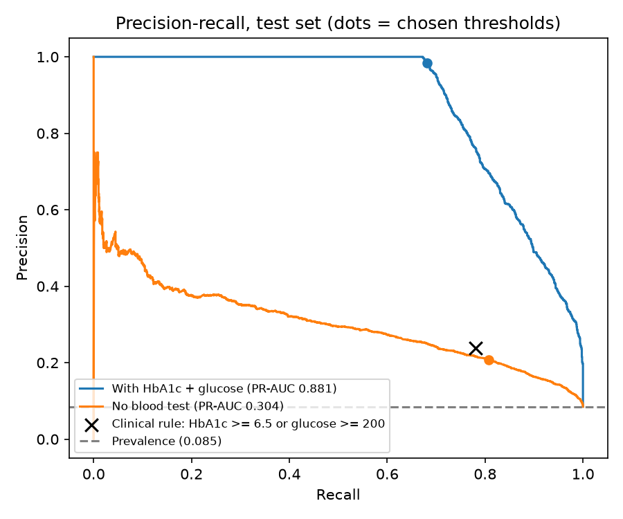

# Diabetes Risk: How Much Do the Blood Tests Do?

Two classifiers on 100,000 patient records, built to answer a practical question: **how well can diabetes be flagged with and without a blood test, and what does a model add over the clinical rule doctors already use?**

| Test set (19,998 patients, 8.5% diabetic) | PR-AUC | ROC-AUC | Recall | Precision | Flagged |
|---|---|---|---|---|---|
| **With HbA1c + glucose** (gradient boosting) | **0.881** (0.869–0.893) | 0.978 | 0.682 | 0.984 | 5.9% |
| **No blood test** (gradient boosting, screening threshold) | **0.304** (0.283–0.326) | 0.832 | 0.808 | 0.208 | 33.0% |
| Clinical rule: HbA1c ≥ 6.5% or glucose ≥ 200 mg/dL | 0.205 | 0.775 | 0.781 | 0.239 | 27.8% |
| Majority-class baseline | 0.085 | 0.500 | 0 | — | 0% |

*95% bootstrap intervals in brackets. All numbers come from [`reports/metrics.json`](reports/metrics.json).*

## Key findings

1. **Without a blood test**, age and BMI carry most of the signal. Flagging a third of patients catches 81% of diabetics, at 21% precision (2.4× the base rate). That is useful as a "who should get tested" screen, not as a diagnosis.
2. **With lab values**, the model is very precise (98%) but misses about 32% of diabetics at the F1-optimal threshold. The PR curve shows the trade-off if a clinic wants higher recall.
3. **The labels are partly rule-generated.**
   - In this dataset, every patient with HbA1c > 6.6% or glucose > 200 mg/dL is labelled diabetic (5,687 of 5,687). That rule covers 67% of all positives.
   - HbA1c takes only 18 distinct values and glucose 18.
   - So the dataset is synthetic or derived, and the "with labs" score largely reflects how the labels were made, not real clinical skill.
   - The ADA rule scores *worse* than the model here only because many label-0 patients sit exactly at 6.5–6.6%. That's another sign the labels don't follow the real diagnostic definition.
4. **Class imbalance:** SMOTE and class weights gave identical results for logistic regression (PR-AUC 0.818 vs 0.818 with labs; 0.315 vs 0.314 without), so the simpler class-weight approach is enough.



## Data

- **Source:** "Comprehensive Diabetes Clinical Dataset (100k rows)" on Kaggle, in [`data/diabetes_dataset.csv`](data/diabetes_dataset.csv).
- **Size:** 100,000 rows, 14 exact duplicates removed before splitting. 8.5% have diabetes.
- **Used features:** age, gender, BMI, hypertension, heart disease, smoking history, HbA1c and blood glucose.
- **Not used:** state and year (no clinical meaning for an individual), and the race indicator columns, to keep the screening model from relying on race. Subgroup results by gender and age are reported below.

## Method

1. Stratified 80/20 train/test split (`random_state=42`). The test set is used once.
2. Every preprocessing step lives inside a scikit-learn / imbalanced-learn `Pipeline`, so it's fit on training folds only. That covers scaling, one-hot encoding, and SMOTE (resampling during fit only).
3. Stratified 5-fold CV on the training set compares:
   - majority class,
   - the clinical rule (with-labs set only),
   - logistic regression with class weights,
   - logistic regression with SMOTE,
   - gradient boosting (`HistGradientBoostingClassifier`).

   The primary metric is **PR-AUC**, because accuracy is meaningless at 8.5% prevalence: predicting "no diabetes" for everyone scores 91.5%.
4. Thresholds are chosen on **out-of-fold training predictions**, never on the test set:
   - With labs: maximise F1.
   - No blood test: highest precision with recall ≥ 80% (screening goal).
5. The chosen model is refit on all training data, then evaluated on the test set:
   - 1,000-sample bootstrap CIs,
   - calibration curve,
   - permutation importance,
   - subgroup recall and precision.

Cross-validation (PR-AUC, mean ± SD of 5 folds), from [`reports/cv_results.csv`](reports/cv_results.csv):

| Model | With labs | No blood test |
|---|---|---|
| Majority class | 0.085 | 0.085 |
| Clinical rule | 0.207 ± 0.002 | — |
| Logistic regression, class weights | 0.818 ± 0.007 | 0.314 ± 0.007 |
| Logistic regression, SMOTE | 0.818 ± 0.007 | 0.315 ± 0.007 |
| **Gradient boosting** | **0.885 ± 0.003** | **0.317 ± 0.010** |

## Model checks

**Calibration:** the predicted probabilities track observed rates closely (Brier 0.023 with labs, 0.067 without).


**What the models use** (drop in PR-AUC when a feature is shuffled):
- With labs: HbA1c dominates (0.61), then glucose (0.19).
- No blood test: age (0.14) and BMI (0.09) lead.


**Subgroups** (no-blood-test screen, test set), from [`reports/subgroups_no_labs.csv`](reports/subgroups_no_labs.csv):

| Group | n | Prevalence | Recall | Precision |
|---|---|---|---|---|
| Female | 11,750 | 7.3% | 0.79 | 0.20 |
| Male | 8,245 | 10.2% | 0.83 | 0.22 |
| Age < 40 | 9,017 | 1.5% | **0.19** | 0.10 |
| Age 40–59 | 5,904 | 10.2% | 0.72 | 0.19 |
| Age 60+ | 5,077 | 18.9% | 0.95 | 0.22 |

The screen works mainly by age. It **misses most diabetics under 40** (recall 0.19). Younger patients would need a separate threshold, or a blood test triggered by other risk factors.

## Limitations

- **Synthetic or rule-derived labels** (see Key findings). Treat this as a modelling exercise, not clinical evidence.
- Cross-sectional data: the model detects existing diabetes, it doesn't predict future onset.
- Not for medical use.

## How to run

```bash
pip install -r requirements.txt
export PYTHONPATH=src           # Windows PowerShell: $env:PYTHONPATH="src"
python -m diabetes.train        # about 3 minutes on a laptop; writes reports/ and models/
python -m diabetes.predict data/diabetes_dataset.csv --model no_labs
pytest -q
```

## Project structure

```
data/diabetes_dataset.csv      input data (100k rows)
src/diabetes/config.py         feature sets, clinical thresholds, paths
src/diabetes/data.py           loading, de-duplication, column validation
src/diabetes/model.py          pipelines and the clinical-rule baseline
src/diabetes/train.py          CV comparison, threshold choice, test evaluation, figures
src/diabetes/predict.py        score new patients from a CSV
tests/                         unit tests
reports/                       metrics, CV results, subgroups, importance, figures
```

The serving side of this model, a FastAPI service with drift monitoring, is in [diabetes-risk-api](https://github.com/Herizhaak/diabetes-risk-api).

## What changed from the first version

The first version reported 97% accuracy. Accuracy is the wrong headline at 8.5% prevalence. This rewrite adds:
- PR-AUC,
- baselines, including the clinical rule,
- cross-validation,
- thresholds tuned out-of-fold,
- a model that needs no blood test,
- calibration and subgroup checks,
- the label-generation finding.

It also removes unused target-encoding code, the committed pickles and test CSVs, and a 1.3 MB notebook output dump.

## Tools

Python · pandas · scikit-learn · imbalanced-learn · Matplotlib · pytest · GitHub Actions
