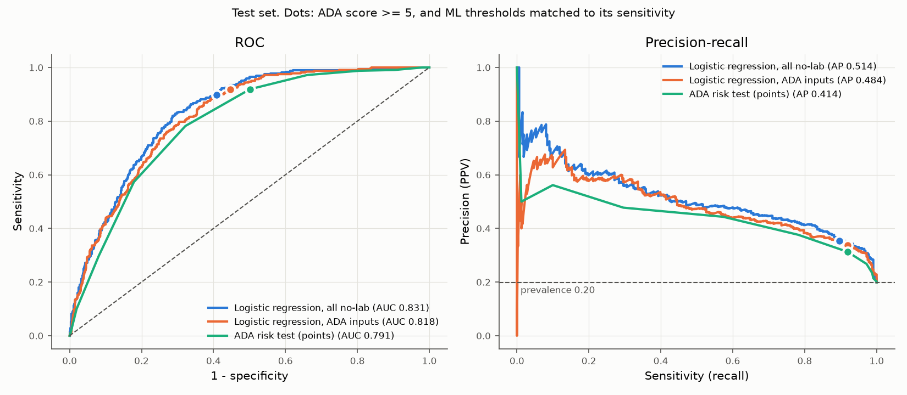
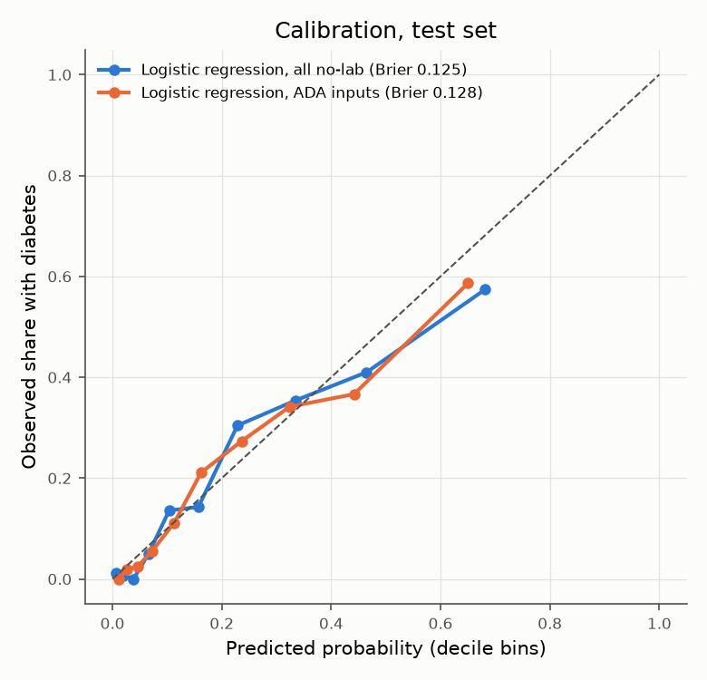
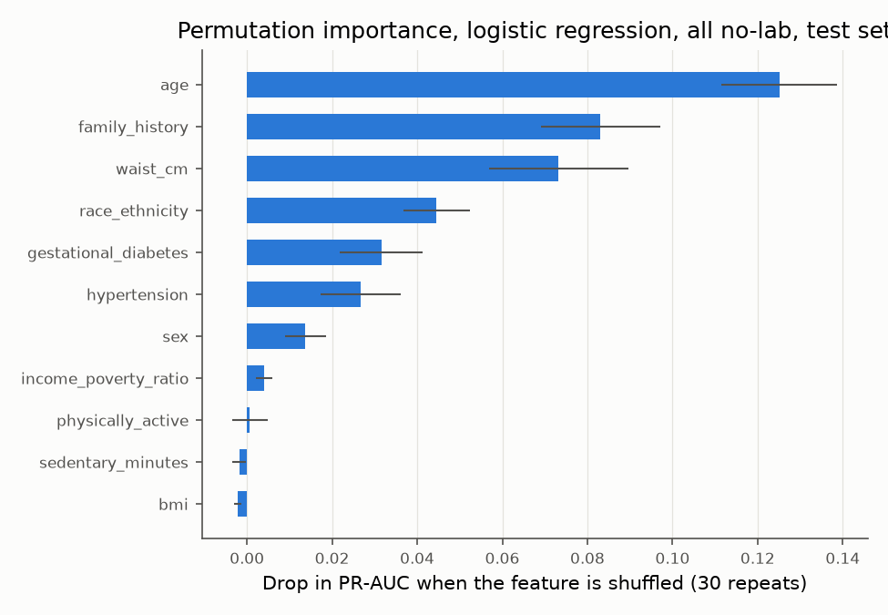
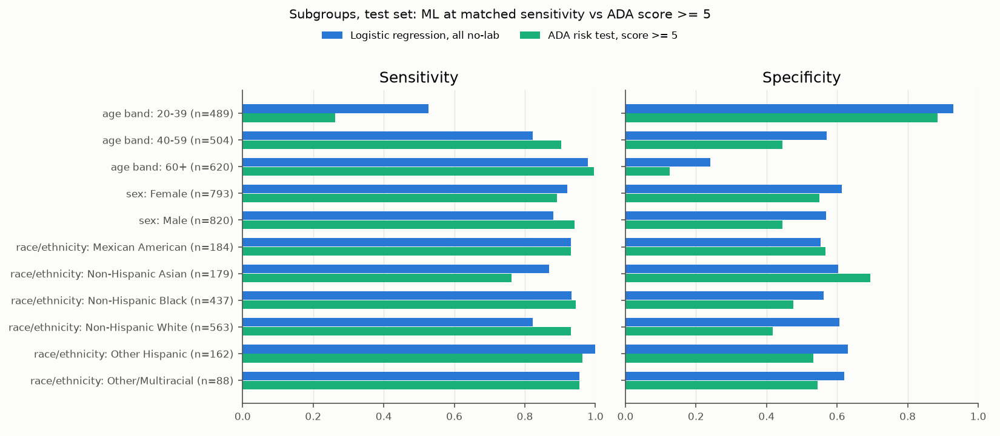

# Diabetes Screening Without a Blood Test: ML vs. the ADA Risk Test (NHANES)

The American Diabetes Association's risk test is a 7-question paper score: age, sex, gestational diabetes, family history, high blood pressure, physical activity and BMI. A total of 5 or more means "get tested". **Can a model trained on the same kind of no-blood-test information do better?**

Data: 8,064 US adults from the CDC's **NHANES 2017–March 2020** survey, with diabetes status confirmed by a lab test.

| Test set (1,613 adults, 321 with diabetes) | ROC-AUC | PR-AUC | Sensitivity | Specificity | PPV | Flagged |
|---|---|---|---|---|---|---|
| **Logistic regression, all no-lab features** | **0.831** (0.809–0.854) | **0.514** (0.456–0.568) | 0.897 | **0.591** | 0.353 | 50.6% |
| Logistic regression, the 7 ADA inputs only | 0.818 (0.794–0.842) | 0.484 (0.428–0.542) | 0.919 | 0.553 | 0.338 | 54.1% |
| ADA risk test, score ≥ 5 | 0.791 (0.766–0.818) | 0.414 (0.368–0.463) | 0.919 | 0.498 | 0.313 | 58.5% |
| Prevalence (no-skill PR-AUC) | 0.5 | 0.199 | | | | |

*95% bootstrap CIs in brackets. The ML thresholds were set on out-of-fold training predictions to match the ADA test's sensitivity (0.90 on the training set), so the comparison is at equal sensitivity. Unweighted sample estimates; survey-weighted versions are in [`reports/metrics.json`](reports/metrics.json).*

## Key findings

1. **Yes, but the gain is modest.** At the same sensitivity, the model's specificity is 9 points higher than the ADA score's (paired bootstrap 95% CI for the difference: +7.3 to +11.3 points). In practice it would send about 8% fewer people for a blood test (CI 6–10%) while catching the same share of cases (sensitivity difference −5.4 to +1.0 points). ROC-AUC improves by +0.025 to +0.055.
2. **More than half of the gain is better modelling, not more data.** Logistic regression on *only* the seven ADA inputs (age and BMI kept continuous, learned weights) already beats the points score: ROC-AUC +0.013 to +0.041, specificity +3.6 to +7.3 points. The rest comes from waist circumference, race/ethnicity and income.
3. **Plain logistic regression beat gradient boosting** in cross-validation: PR-AUC 0.537 ± 0.023 vs 0.519 ± 0.026. With 6,400 training rows and mostly binary inputs, there's little non-linear structure to find.
4. **The real screening target is people who don't know they have diabetes.** About **16% of adults with diabetes are undiagnosed** (survey-weighted, 95% CI 14–19%). Among the 6,743 adults *without* a diagnosis (284 undiagnosed cases, 4.2%), out-of-fold results were:
   - ROC-AUC 0.785 (0.763–0.805) for the model vs 0.737 (0.713–0.763) for the ADA score.
   - At equal sensitivity (0.85), specificity is 0.576 vs 0.515.
   - Both still flag 44–50% of people at a PPV of only 7–8%. Questionnaire screening is a coarse filter.
5. **One blood test beats any questionnaire.** In the fasting subsample (n = 3,955), adding fasting glucose to the no-lab model lifts out-of-fold ROC-AUC from 0.832 to 0.936 and PR-AUC from 0.52 to 0.85. Fasting glucose is not part of the outcome definition, so this is not circular.



## Data

- **Source:** CDC / NCHS [National Health and Nutrition Examination Survey](https://wwwn.cdc.gov/nchs/nhanes/), 2017–March 2020 pre-pandemic files. US government work, public domain.
- **Files:** `P_DEMO`, `P_BMX`, `P_BPQ`, `P_DIQ`, `P_MCQ`, `P_PAQ`, `P_RHQ`, `P_GHB`, `P_GLU`.
  - [`src/diabetes/nhanes.py`](src/diabetes/nhanes.py) downloads them from pinned URLs, checks each file's SHA-256, caches them in `data/raw/` (git-ignored), and builds [`data/nhanes_2017_2020_adults.csv`](data/nhanes_2017_2020_adults.csv) (0.7 MB, committed so tests and CI never depend on the CDC server).
- **Why not 2021–2023?** The newer cycle (`_L` files) was checked first. It dropped both the family-history question (MCQ300C) and the gestational-diabetes question (RHQ162), and the ADA test needs both.
- **Population:** adults aged 20 and over who were examined at the mobile exam centre (MEC). Excluded:
  - pregnant women,
  - people who did not answer the diabetes question,
  - people with neither a diagnosis nor an HbA1c result.
- **Outcome:** `diabetes = 1` if a doctor ever said the person has diabetes (DIQ010 = 1) **or** HbA1c ≥ 6.5%. "Borderline" answers count as not diagnosed.
  - **Fasting glucose ≥ 126 mg/dL is not part of the label.** It was measured only in a morning fasting subsample, so using it would apply a different outcome definition to half the people.
  - In that subsample, adding it would raise weighted prevalence from 14.0% to 16.2%. The label therefore slightly undercounts diabetes; it is the HbA1c-or-diagnosis definition, not the full ADA one.
- **Prevalence:** 19.9% in the sample (1,605 cases). The survey-weighted US estimate is **14.6% (95% CI 13.7–15.4%)**, using MEC weights with Taylor-linearised design-based CIs ([`survey.py`](src/diabetes/survey.py)). The sample over-represents older and minority adults by design.

### Features (no blood test)

| Feature | NHANES source | Notes |
|---|---|---|
| `age` | RIDAGEYR | top-coded at 80 |
| `sex` | RIAGENDR | |
| `race_ethnicity` | RIDRETH3 | 6 groups, incl. Non-Hispanic Asian |
| `income_poverty_ratio` | INDFMPIR | 14% missing |
| `bmi`, `waist_cm` | BMXBMI, BMXWAIST | measured, not self-reported |
| `hypertension` | BPQ020 | ever told high blood pressure |
| `family_history` | MCQ300C | parent or sibling with diabetes |
| `gestational_diabetes` | RHQ162 | 0 for men and never-pregnant women, as on the ADA form |
| `physically_active` | PAQ650, PAQ665 | any moderate or vigorous leisure-time activity |
| `sedentary_minutes` | PAD680 | minutes sitting per day |

HbA1c is **never** a model feature, because it defines the label. "Refused" and "don't know" answers become missing values, which are imputed inside the pipeline (median or most frequent, plus missingness indicator columns).

## Method

1. **ADA risk test baseline.** [`ADARiskScore`](src/diabetes/model.py) is a scikit-learn-compatible classifier (`ClassifierMixin, BaseEstimator`) with no learned parameters, so it goes through the same CV and test code as the models.
   - Points: age 40–49 = 1, 50–59 = 2, 60+ = 3; male = 1; gestational diabetes = 1; family history = 1; hypertension = 1; not physically active = 1; BMI 25–29.9 = 1, 30–39.9 = 2, ≥ 40 = 3.
   - ≥ 5 = high risk ([Bang et al., *Ann Intern Med* 2009;151:775–83](https://pubmed.ncbi.nlm.nih.gov/19949143/), as adapted in the ADA test).
   - An unanswered item scores 0. The original paper's version (active = −1, no gestational item) is reported too: ROC-AUC 0.785, sensitivity 0.77, specificity 0.68 at ≥ 5.
2. **Stratified 80/20 split** (`random_state=42`). The test set is used once.
3. **Model comparison** with `RepeatedStratifiedKFold` (5 folds × 3 repeats) on the training set. All preprocessing lives inside `Pipeline`s, so it's fit on training folds only. Results from [`reports/cv_results.csv`](reports/cv_results.csv):

   | Model | Features | PR-AUC | ROC-AUC | Brier |
   |---|---|---|---|---|
   | Prior (majority) | – | 0.199 | 0.500 | 0.159 |
   | ADA risk test (points) | 7 ADA inputs | 0.457 ± 0.024 | 0.802 ± 0.014 | – |
   | Logistic regression | 7 ADA inputs | 0.516 ± 0.025 | 0.822 ± 0.014 | 0.124 |
   | **Logistic regression** | **all no-lab** | **0.537 ± 0.023** | **0.836 ± 0.010** | **0.121** |
   | Gradient boosting (`HistGradientBoosting`) | all no-lab | 0.519 ± 0.026 | 0.825 ± 0.011 | 0.124 |

4. **Thresholds** come from **out-of-fold** training predictions. Each model's threshold is the highest one that reaches the ADA test's training-set sensitivity, which makes specificity, PPV and the share flagged directly comparable.
5. **Test-set evaluation**, with 1,000-sample paired bootstrap CIs for each metric and for the model-minus-ADA differences. Also: calibration, subgroups (age band, sex, race/ethnicity), and permutation importance (30 repeats).
6. **Secondary analyses:**
   - **Undiagnosed diabetes:** re-run the comparison among people without a diagnosis, using 5-fold out-of-fold predictions.
   - **One-blood-test ceiling:** add fasting glucose to the no-lab model, within the fasting subsample.

## Survey design

NHANES oversamples some groups, so unweighted metrics describe *this sample*, not the US population.

- **Prevalence and the undiagnosed share** are survey-weighted, with design-based CIs.
- **Model metrics** are reported both unweighted (headline) and MEC-weighted (point estimates).
  - Weighted test ROC-AUC: 0.840 for the model vs 0.797 for the ADA score.
  - Weighted specificity: 0.700 vs 0.543. Weighted sensitivity: 0.800 vs 0.913.
  - So at population weights, the threshold tuned on the unweighted sample catches fewer cases than the ADA test. A deployed screen would need its threshold re-set on weighted data.
- **Models are trained unweighted.** Bootstrap CIs resample people and ignore clustering, so they are somewhat too narrow.

## Model checks

**Calibration:** the logistic model's probabilities track observed rates up to about 0.4, then over-predict slightly at the top (Brier 0.125). The ADA points total is not a probability, so it has no calibration curve.



**What the model uses** (drop in test PR-AUC when shuffled, [`permutation_importance.csv`](reports/permutation_importance.csv)):
1. age (0.125)
2. family history (0.083)
3. waist circumference (0.073)
4. race/ethnicity (0.045)
5. gestational diabetes (0.032)
6. hypertension (0.027)

BMI scores about 0 only because waist carries the same information; the two correlate strongly. Self-reported physical activity and sitting time add nothing measurable.



**Subgroups** (test set, [`reports/subgroups.csv`](reports/subgroups.csv)):

| Group | n (cases) | ROC-AUC model / ADA | Sensitivity model / ADA | Specificity model / ADA |
|---|---|---|---|---|
| Age 20–39 | 489 (19) | 0.82 / 0.70 | **0.53 / 0.26** | 0.93 / 0.89 |
| Age 40–59 | 504 (113) | 0.80 / 0.75 | 0.82 / 0.90 | 0.57 / 0.45 |
| Age 60+ | 620 (189) | 0.75 / 0.69 | 0.98 / 0.99 | **0.24 / 0.13** |
| Female | 793 (137) | 0.85 / 0.80 | 0.92 / 0.89 | 0.61 / 0.55 |
| Male | 820 (184) | 0.82 / 0.77 | 0.88 / 0.94 | 0.57 / 0.45 |
| Mexican American | 184 (43) | 0.86 / 0.85 | 0.93 / 0.93 | 0.55 / 0.57 |
| Other Hispanic | 162 (27) | 0.89 / 0.87 | 1.00 / 0.96 | 0.63 / 0.53 |
| Non-Hispanic White | 563 (101) | 0.79 / 0.76 | 0.82 / 0.93 | 0.61 / 0.42 |
| Non-Hispanic Black | 437 (90) | 0.85 / 0.79 | 0.93 / 0.94 | 0.56 / 0.48 |
| Non-Hispanic Asian | 179 (38) | 0.81 / 0.79 | **0.87 / 0.76** | 0.60 / 0.69 |
| Other/Multiracial | 88 (22) | 0.86 / 0.85 | 0.95 / 0.95 | 0.62 / 0.55 |



- **Both tools are mostly age screens.**
  - Over 60, almost everyone is flagged: specificity is 0.24 for the model and 0.13 for the ADA score.
  - Under 40, most cases are missed, though the model misses fewer (sensitivity 0.53 vs 0.26). Only 19 cases, so this is very uncertain.
- **The ADA score misses more Asian American adults** (sensitivity 0.76). This is consistent with diabetes appearing at lower BMI in Asian populations; the ADA recommends screening Asian Americans from BMI 23 rather than 25, and this baseline uses the general cut-offs.
- Subgroup cells have 19–189 cases. Treat differences of a few points as noise.

## Limitations

- **Cross-sectional.** The models detect *existing* diabetes; they don't predict future onset.
- **Reverse causation.** People with diagnosed diabetes may have changed their weight or activity, or been checked for blood pressure, *because* of the diagnosis. The undiagnosed-only analysis avoids this and shows a smaller gain (ROC-AUC 0.785 vs 0.737).
- **Outcome definition.** The label is diagnosis or HbA1c ≥ 6.5%, with no fasting glucose and no repeat test. It mixes type 1 and type 2 diabetes. HbA1c is affected by anaemia and some haemoglobin variants.
- **Self-reported inputs.** Hypertension, family history, gestational diabetes and activity are recall-based. BMI and waist were measured by staff, which makes this comparison kinder to both tools than home self-assessment would be.
- **Single survey cycle, no external validation.** The ADA test was developed on earlier NHANES cycles (1999–2004), which may give it a slight home advantage here, or a disadvantage if populations changed.
- **Race/ethnicity as an input.** It improves accuracy here, but using it in a clinical score is debated. Subgroup error rates are reported above, but no formal fairness audit was done.
- **Not a medical device** and not for clinical decisions.

## How to run

```bash
pip install -r requirements.txt
export PYTHONPATH=src           # Windows PowerShell: $env:PYTHONPATH="src"
python -m diabetes.nhanes       # optional: re-download the CDC files and rebuild the CSV
python -m diabetes.train        # about 2 minutes; writes reports/ and models/
python -m diabetes.predict data/nhanes_2017_2020_adults.csv --model no_labs
pytest -q
```

## Project structure

```
data/nhanes_2017_2020_adults.csv   processed analysis table (8,064 adults)
data/raw/                          cached CDC XPT files (git-ignored)
src/diabetes/config.py             file list + hashes, outcome cut-offs, feature sets
src/diabetes/nhanes.py             download, verify, recode and join NHANES files
src/diabetes/data.py               loading and schema checks
src/diabetes/model.py              ADA risk-test scorer and model pipelines
src/diabetes/survey.py             survey-weighted prevalence with design-based CIs
src/diabetes/train.py              CV, matched-sensitivity thresholds, test evaluation, figures
src/diabetes/predict.py            score new people from a CSV (model + ADA points)
tests/                             unit tests
reports/                           metrics, CV results, subgroups, importance, figures
```

The serving side of this model, a FastAPI service with drift monitoring trained on the same features, is in [diabetes-risk-api](https://github.com/Herizhaak/diabetes-risk-api).

## Tools

Python · pandas · scikit-learn · Matplotlib · pytest · GitHub Actions
